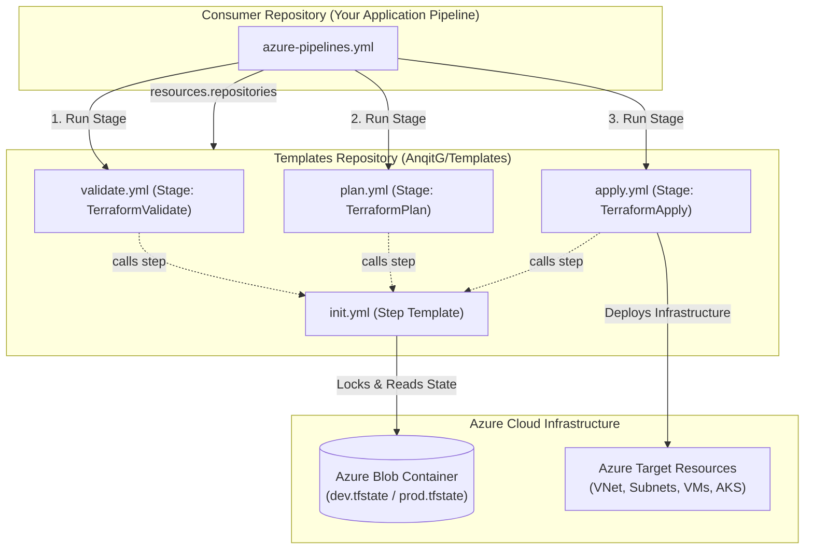

<div align="center">

  # ⚡ Terraform CI/CD Reusable Templates for Azure DevOps ⚡

  <p align="center">
    <a href="https://git.io/typing-svg">
      
    </a>
  </p>

  <p align="center">
    
    
    
    
  </p>

  <p align="center">
    <b>A plug-and-play, enterprise-grade suite of Azure DevOps YAML templates designed to automate Terraform workflows across multiple environments with zero redundancy.</b>
  </p>

  ---
</div>

## 📑 Table of Contents
- [🌟 Key Highlights](#-key-highlights)
- [🏗️ Pipeline Architecture](#️-pipeline-architecture)
- [📂 Repository Structure](#-repository-structure)
- [🚀 Quick Start (Caller Pipeline)](#-quick-start-caller-pipeline)
- [🧩 Template Deep Dive & Parameters](#-template-deep-dive--parameters)
  - [1. `init.yml` (Step Template)](#1-inityml-step-template)
  - [2. `validate.yml` (Stage Template)](#2-validateyml-stage-template)
  - [3. `plan.yml` (Stage Template)](#3-planyml-stage-template)
  - [4. `apply.yml` (Stage Template)](#4-applyyml-stage-template)
- [🛡️ Production Best Practices](#️-production-best-practices)
- [🤝 Contributing & Support](#-contributing--support)

---

## 🌟 Key Highlights

- 🔄 **Fully Generic & Parameterized**: No hardcoded environment names, subscriptions, or storage backends. Pass parameters or fall back cleanly to your pipeline variables.
- 🏢 **Multi-Repo Federation**: Consume templates directly in your projects via `resources.repositories` syntax in Azure DevOps.
- 📦 **DRY (Don't Repeat Yourself)**: All stages leverage `init.yml` as a shared baseline, eliminating duplicated CLI installation and backend authentication steps.
- 🔒 **Dynamic State Isolation**: Automatically provisions and routes environment-specific state files (`<env>.tfstate`) into Azure Blob Storage.
- 🚦 **Dependency Flow**: Out-of-the-box stage orchestration (`TerraformValidate` ➔ `TerraformPlan` ➔ `TerraformApply`), preventing apply on failed plans or syntax errors.

---

## 🏗️ Pipeline Architecture



---

## 📂 Repository Structure

```plaintext
📦 Templates
├── 📜 init.yml        # Shared Step Template: Installs Terraform & inits AzureRM Backend
├── 📜 validate.yml    # Stage Template: Runs Terraform Format & Validation
├── 📜 plan.yml        # Stage Template: Runs Terraform Plan for target Environment
├── 📜 apply.yml       # Stage Template: Runs Terraform Apply for target Environment
└── 📘 README.md       # Repository documentation & usage guidelines
```

---

## 🚀 Quick Start (Caller Pipeline)

Here is how you consume these templates inside your application repository (`azure-pipelines.yml`):

```yaml
trigger: none

pool:
  vmImage: ubuntu-latest

parameters:
  - name: env
    displayName: 'Deployment Target Environment'
    type: string
    default: dev
    values:
      - dev
      - prod

# 1. Environment-specific Variable Groups
variables:
  - ${{ if eq(parameters.env, 'dev') }}:
      - group: VG-dev
  - ${{ if eq(parameters.env, 'prod') }}:
      - group: VG-prod
  - name: wd
    value: '$(System.DefaultWorkingDirectory)/Environment/${{ parameters.env }}'
  - name: sc
    value: 'Practice_service_connection'

# 2. Link this Reusable Templates Repository
resources:
  repositories:
    - repository: templateRepo
      type: github
      name: AnqitG/Templates
      endpoint: github.com_AnqitG
      ref: refs/heads/main # Or use version tag like refs/tags/V1.2

# 3. Call the Standardized Pipeline Stages
stages:
  - template: validate.yml@templateRepo
    parameters:
      env: ${{ parameters.env }}
      wd: $(wd)
      sc: $(sc)

  - template: plan.yml@templateRepo
    parameters:
      env: ${{ parameters.env }}
      wd: $(wd)
      sc: $(sc)

  - template: apply.yml@templateRepo
    parameters:
      env: ${{ parameters.env }}
      wd: $(wd)
      sc: $(sc)
```

---

## 🧩 Template Deep Dive & Parameters

### 1. `init.yml` (Step Template)
Handles dynamic Terraform CLI installation via `TerraformInstaller@1` and configures Azure Storage Remote Backend authentication via `TerraformTask@5`.

| Parameter | Type | Default | Description |
| :--- | :--- | :--- | :--- |
| `wd` | `string` | `$(System.DefaultWorkingDirectory)` | Path to directory containing `.tf` files. |
| `sc` | `string` | *(Required)* | Azure Resource Manager Service Connection name. |
| `key` | `string` | `'default'` | State file prefix (e.g. `'dev'` creates `'dev.tfstate'`). |
| `terraformVersion` | `string` | `'latest'` | Exact Terraform CLI version or `'latest'`. |
| `backendRg` | `string` | `'$(rg)'` | Azure Resource Group hosting backend storage. |
| `backendSa` | `string` | `'$(sa)'` | Azure Storage Account name for state backend. |
| `backendContainer`| `string` | `'$(container)'` | Storage Container name for state blobs. |

---

### 2. `validate.yml` (Stage Template)
Executes `terraform validate` after initializing the backend to ensure syntax and configuration validity.

| Parameter | Type | Default | Description |
| :--- | :--- | :--- | :--- |
| `wd` | `string` | `$(System.DefaultWorkingDirectory)` | Working directory for Terraform configuration. |
| `env` | `string` | `'dev'` | Target environment name (e.g. `dev`, `uat`, `prod`). |
| `sc` | `string` | *(Required)* | Azure Resource Manager Service Connection name. |
| `terraformVersion`| `string` | `'latest'` | Terraform CLI version to install. |
| `backendRg` | `string` | `'$(rg)'` | Azure Resource Group hosting state storage. |
| `backendSa` | `string` | `'$(sa)'` | Azure Storage Account name for state files. |
| `backendContainer`| `string` | `'$(container)'` | Storage Container name for state blobs. |
| `poolName` | `string` | `'ubuntu-latest'` | Build agent VM Image pool. |

---

### 3. `plan.yml` (Stage Template)
Executes `terraform plan` to calculate infrastructure delta and verify provider authentication. Depends on `TerraformValidate<env>` by default.

| Parameter | Type | Default | Description |
| :--- | :--- | :--- | :--- |
| `wd` | `string` | `$(System.DefaultWorkingDirectory)` | Working directory for Terraform configuration. |
| `env` | `string` | `'dev'` | Target environment name. |
| `sc` | `string` | *(Required)* | Azure Resource Manager Service Connection name. |
| `terraformVersion`| `string` | `'latest'` | Terraform CLI version to install. |
| `backendRg` | `string` | `'$(rg)'` | Azure Resource Group hosting state storage. |
| `backendSa` | `string` | `'$(sa)'` | Azure Storage Account name for state files. |
| `backendContainer`| `string` | `'$(container)'` | Storage Container name for state blobs. |
| `poolName` | `string` | `'ubuntu-latest'` | Build agent VM Image pool. |
| `dependsOn` | `object` | `[]` *(Defaults to Validate)* | Custom stage dependency array if required. |

---

### 4. `apply.yml` (Stage Template)
Executes `terraform apply` against target Azure subscription. Automatically gated to run only after a successful `TerraformPlan<env>`.

| Parameter | Type | Default | Description |
| :--- | :--- | :--- | :--- |
| `wd` | `string` | `$(System.DefaultWorkingDirectory)` | Working directory for Terraform configuration. |
| `env` | `string` | `'dev'` | Target environment name. |
| `sc` | `string` | *(Required)* | Azure Resource Manager Service Connection name. |
| `terraformVersion`| `string` | `'latest'` | Terraform CLI version to install. |
| `backendRg` | `string` | `'$(rg)'` | Azure Resource Group hosting state storage. |
| `backendSa` | `string` | `'$(sa)'` | Azure Storage Account name for state files. |
| `backendContainer`| `string` | `'$(container)'` | Storage Container name for state blobs. |
| `poolName` | `string` | `'ubuntu-latest'` | Build agent VM Image pool. |
| `dependsOn` | `object` | `[]` *(Defaults to Plan)* | Custom stage dependency array if required. |

---

## 🛡️ Production Best Practices

> [!TIP]
> **Semantic Versioning & Git Tags**:
> Always reference template repos in consumer pipelines using git tags (e.g., `ref: refs/tags/v1.0.0`) rather than `refs/heads/main` to prevent breaking changes in consumer pipelines.

> [!IMPORTANT]
> **Environment Protection & Approvals**:
> In enterprise environments, configure Environment Approvals in Azure DevOps under **Pipelines ➔ Environments ➔ Approvals and Checks** for production environments before executing `apply.yml`.

> [!NOTE]
> **Dynamic Fallbacks**:
> All backend parameters default to standard pipeline variables `$(rg)`, `$(sa)`, and `$(container)`. If your variable group defines these keys, you don't even need to pass them explicitly!

---

<div align="center">
  <sub>Maintained with ❤️ by <b><a href="https://github.com/AnqitG">Anqit Gupta</a></b> (<b>@AnqitG</b>) | Built for Enterprise Cloud DevOps Automation</sub>
</div>
